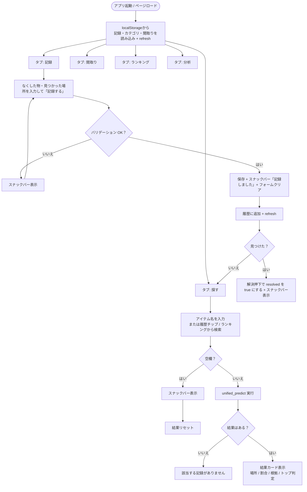
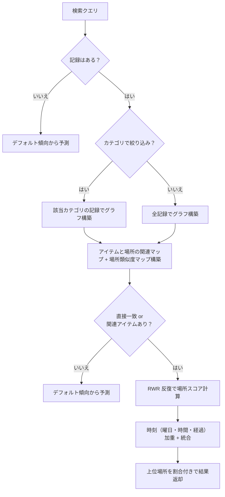
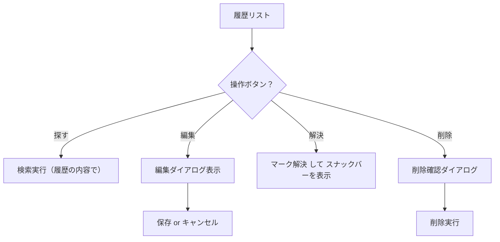
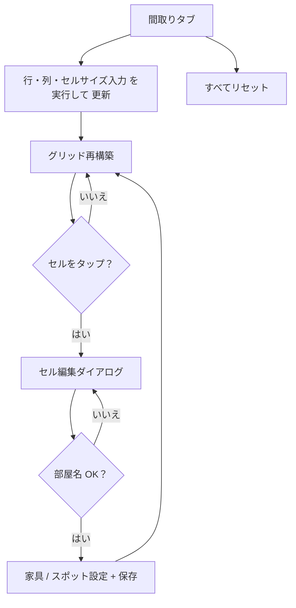
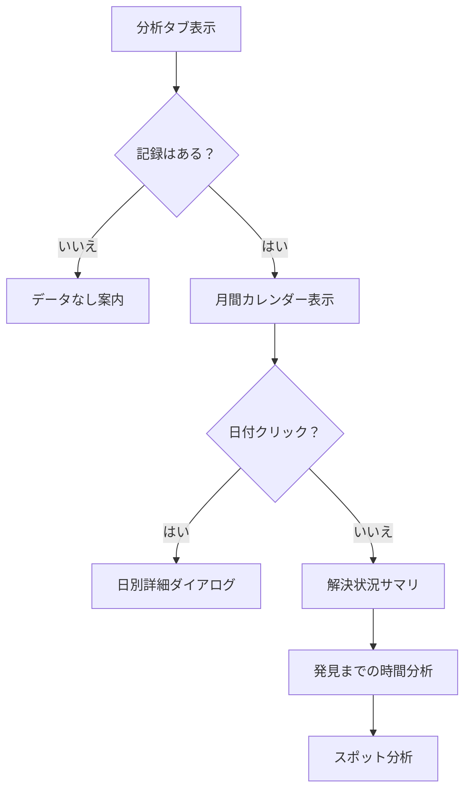
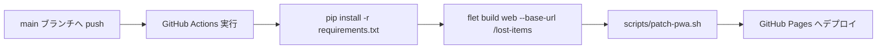
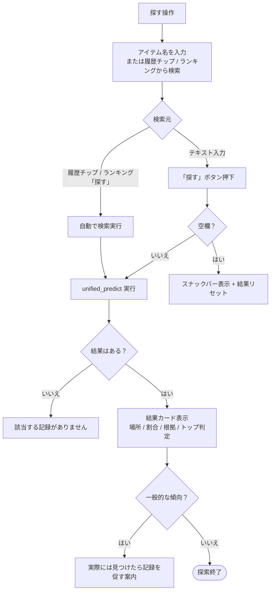
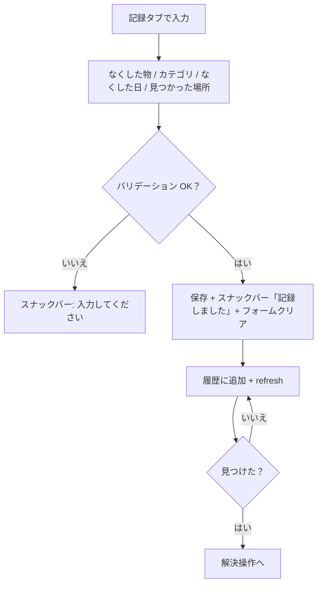
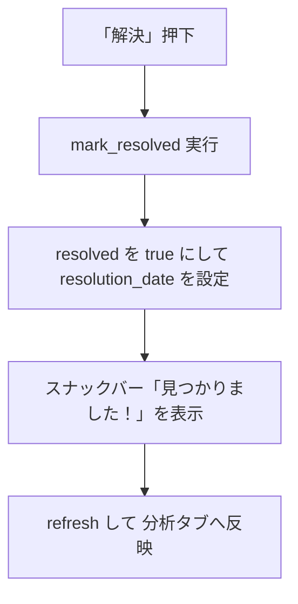

# なくしもの探知機（Lost Items Finder）

Flet Web アプリ（Pyodide / GitHub Pages デプロイ）  
🔗 **https://shin488.github.io/lost-items/**

忘れ物を見つけるまでの時間を減らすための、アイテム別忘れ物検索・記録・分析アプリ。

---

## フローチャート

### 1. アプリ全体のフロー

### 2. 検索ロジックの分岐

### 3. 記録操作（履歴）

### 4. 間取り編集

### 5. 分析

### 6. デプロイ（CI/CD）

### 7. アプリ内の操作フロー（詳細）

#### 7-1. 探す操作

#### 7-2. 記録操作（追加・編集・削除）

#### 7-3. 解決操作

---

## 補足

- 検索（フローチャート 2）は `predict.py` の RWR（Random Walk with Restart）による 
  アイテムと場所の関連グラフの推論と、記録の時刻情報（曜日・時間・経過日数）を組み合わせた加重集計で動作する。
- 未解決の記録は「見つけた」を押すと `resolved` フラグが立ち、分析タブの 
  解決率・発見までの時間に反映される。
- フローチャートはコードベースの変更に合わせて随時更新する前提。
