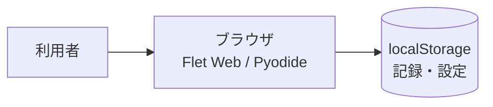
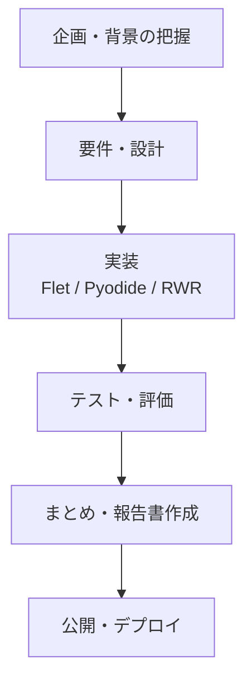
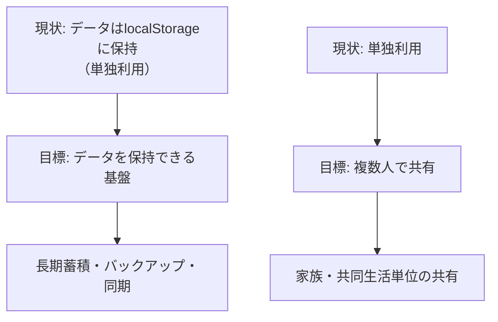

# 卒業制作作品報告書

※本ファイルは `graduation_project_template.md` の記入例である。作品・人物・数値はすべて架空のものである。

## 1. 基本情報

- **作品名**：なくしもの探知機（Lost Items Finder）
- **英語タイトル**：Lost Items Finder: Predicting Where Lost Household Items Are
- **制作者名**：瑞穂太郎（みずほたろう）
- **学籍番号**：非公開（個人情報保護のため、公開する報告書には記載しない）
- **所属ゼミ・研究室**：kklab
- **制作期間**：2026年4月〜2026年10月
- **作品の種類**：Webアプリ（フロントエンド：Flet / Pyodide、推論エンジン：グラフRWR）
- **作品URL**：https://shin488.github.io/lost-items/
- **ソースコードURL**：https://github.com/shin488/lost-items
- **デモ動画URL**：なし

---

## 2. 作品概要

### 2.1 概要

本作品は、家庭内で発生した忘れ物（スマートフォン・財布・鍵・イヤホン等）を、利用者が「探す」「記録」「解決」「分析」の流れで管理・追跡できるようにするWebアプリケーションである。開発は、Flet 0.85.2をWebブラウザ上で動作させるFlet Web / Pyodide構成に加え、Python製の推論エンジン（グラフRWR）を用いて実装した。

### 2.2 一言で表すと

**本作品は、思い出せない忘れ物の正体を、過去の記録と推論に基づいて見つかりそうな場所を予測し、見つけたら解決までたどるWebアプリである。**

### 2.3 作品の特徴

- 特徴1：記録ベースの推論エンジン（Random Walk with Restart: RWR）により、過去の紛失記録のグラフから「どのアイテムが・どの場所で」紛失しやすいかをスコア化して予測する。
- 特徴2：間取りデータ（部屋 > 家具 > スポット）の階層的定義と連携し、具体的な紛失場所を記録・検索できる。
- 特徴3：Flet Web + Pyodide + GitHub Pages / PWA（Service Worker・オフラインキャッシュ）構成により、家庭内でいつでも利用できる公開形態を実現する。

---

## 3. 背景と問題意識

### 3.1 制作の背景

日常生活において、スマートフォンや財布、鍵等の持ち物が自転車や車の中、ソファの裏、カバンの奥などに置き忘れられ、本人が気づかないうちに紛失となるケースは少なくない。また、家族・友人などの第三者への持ち歩き紛失も同様に発生する。本プロジェクトの制作者自身も、スマートフォンをカバンに入れ忘れる体験を繰り返し、その場で気づかないことで「もう一度だけ」という思い出せない状態に陥ったことが制作の契機となった。人に問い合わせる・記憶を頼るという古典的な探し方は手軽だが、本人の認識や状況に依存するため、実際には放置されがちである。

### 3.2 解決したい課題

本作品が解決を目指す課題は、以下の3点である。

1. **思い出せない**：紛失の本人が、何がいつ・どこで紛失したのかを思い出せない。
2. **探す手間**：紛失の本人だけでなく、家族や同乗者など「探す側」が、過去の文脈を踏まえた探索を行うことが難しい。
3. **解決の不完全さ**：見つかったかどうかを記録し、次回以降の探索や分析に活かせていない。

### 3.3 既存の方法とその限界

| 既存の製品・方法 | 主な特徴 | 課題・限界 |
|---|---|---|
| SNSやWeb検索で本人に問い合わせる | 気軽に尋ねられる | 本人への認知が難しく、放置されるケースがある |
| 紙やメモアプリでの手動記録 | 最低限の記録は可能 | 検索・予測・分析の基盤がなく、再利用されない |
| 紛失用品の保管ボックス／防犯用品 | 第三者による保管・防止 | 本来「探してほしい」持ち主が利用できない |

---

## 4. 想定する利用者

### 4.1 主な利用者

- 忘れた本人（スマートフォン・財布・鍵等の持ち主に紛失が発生し、本人・家族・同乗者の間で探す側が利用する）。
- 家族・同乗者（紛失時の探索を主導する「探す側」）。

### 4.2 ペルソナ

| 項目 | 内容 |
|---|---|
| 名前 | 山田 太郎（仮名） |
| 年齢・職業 | 26歳・IT企業勤務の社会人 |
| 生活環境 | 東京都内で一人暮らし。買い物時はまとめ買いをする習慣がある。 |
| 困っていること | スマートフォンをカバンに入れ忘れ、3日間放置してしまい、気づいたときには自宅のソファの裏にあった。 |
| 現在の対処方法 | SNSで「スマホ落ちた」と投稿するが、見つからず放置した。 |
| この作品に期待すること | 次回、どこに置き忘れそうかを記録しておけば、次回の探索で過去の文脈を踏まえて見つけやすくなる。 |

### 4.3 その他のステークホルダー

- 家族：高齢者の認知機能の低下や、子ども（子供）の所在確認など、探索の主体となる場合がある。
- 行政・地域：行方不明者・紛失品の把握など、地域全体での見守りの基盤になり得る。
- 引っ越し業者・不用品回収業者：紛失品の回収・保管サービスを利用する側。

---

## 5. 提案する解決方法

### 5.1 コンセプト

本作品のコンセプトは「**探す人が、探す負担を減らす**」ことである。利用者が失物を記録し、過去のデータと推論に基づいて「見つかりそうな場所」を予測すれば、探索は思い出に頼らず、体系的な検索へ移行できる。これにより、忘れ物が「解決」まで一連の流れで扱える。

### 5.2 提供する価値

- 記録者が失物を失った瞬間に情報を蓄積でき、探索の土台となる。
- 推論エンジンが記録から傾向を算出し、探索の選択肢を提示する。
- 解決が「found_date」等として記録され、分析で振り返れる。

### 5.3 主要機能

| 機能名 | 機能の説明 | 解決する課題 |
|---|---|---|
| 探索機能 | テキスト入力・履歴チップ・ランキングからの検索を、RWR推論で場所予測して結果表示 | 思い出せない |
| 記録機能 | なくした物・カテゴリ・日時・場所の入力と保存、編集・削除・解決 | 検索基盤の欠如 |
| 間取り連携 | 行×列グリッド上の部屋・家具・スポットの階層的指定 | 場所不明 |
| ランキング | よくなくした物の傾向ランキング | 頻度の把握 |
| 分析 | 月間カレンダー・解決率・発見までの時間・スポット分析 | 改善循環 |
| PWA / 自動デプロイ | GitHub Pages + Service Worker + GitHub Actions | 継続利用 |

---

## 6. SFプロトタイピング

### 6.1 想定する未来

- **想定年代**：2040年
- **場所・地域**：日本の郊外住宅地
- **社会の状況**：家電・IoT機器と家庭内のデータ連携が標準化され、AIエージェントが家庭の在庫・紛失情報を管理する。また、地域間での「忘れ物」の融通（シェア）が制度化されている。
- **技術の状況**：AIエージェントが家庭内の音声・画像・位置情報（自宅内のみ）を統合し、紛失を自動検知・探索支援する。
- **人々の生活や価値観**：忘れ物は「管理コスト」として扱われる社会。一方で「大切な物だから手放したくない」という所有欲は残る。
- **現在と大きく異なる点**：現在はユーザーが自分で記録するが、2040年では家庭内のAIエージェントが自律的に記録・探索する。

### 6.2 未来に至るまでの変化

| 時期 | 社会・技術の変化 | 作品との関係 |
|---|---|---|
| 現在 | スマホ・財布の紛失が個人リスクとして認識される | 手動記録＋RWR推論で「探す側」を支援 |
| 3年後 | IoT家電と在庫データの連携が普及 | 自動記録・自動推論の精度が向上 |
| 5年後 | 地域のシェア・融通制度が整備 | 探索結果が地域間で共有される |
| 10年後 | AIエージェントが家庭の紛失を検知・解決する | エージェントが完全に自律的に遂行 |

### 6.3 未来の前提

- 技術的前提：家庭内のIoTデバイスとAIエージェントの相互運用性。
- 経済的前限：AIエージェント運用にかかるコストが個人負担で可能になる。
- 社会的前提：個人データのプライバシー保護と、共有・融通の法的枠組み。
- 環境的前提：エネルギー消費の削減（紛失→不要な購入の抑制）。

### 6.4 未来の物語

> 2040年、郊外の一軒家。  
> 母が帰宅すると、玄関のスマートフォン（AIエージェント管理下）の電源がオフになっていることに気づく。エージェントが自宅内の音・映像・購入履歴と連携し、「お母のスマホはベッドの下の収納に置き忘れられた」と検知した。探索をAIエージェントが実行し、収納を開けるとスマホは見つかる。  
> 一方、エージェントは同じ収納に置き忘れていた「鍵」も検知し、母は自宅の鍵を紛失したことを思い出す。鍵は玄関の鍵置きにあり、そのまま解決。  
> さらにAIエージェントは、購入履歴と在庫から「冷蔵庫に残っていた牛乳を使い切る献立」を提案した。  
> 家庭は、記憶とデータがAIによって橋渡しされた。

### 6.5 未来における作品の役割

- 誰が利用するのか：家庭に所有するAIエージェント（利用者本人・家族）。
- いつ利用するのか：忘れ物が起きたとき・日常の記録更新時。
- どこで利用するのか：家庭内のIoTデバイス・スマートフォン・クラウド。
- どの問題を解決するのか：家庭内の忘れ物（データ・物理的所在）の解消。
- 社会にどのような影響を与えるのか：個人情報・共有の在り方、紛失解決のコスト。
- 作品が存在しない場合、何が起こるのか：記憶に頼る探索が続く。

### 6.6 未来画像


**図1：2040年において本作品が活用されている様子**

#### 画像の説明

2040年の家庭で、AIエージェントが紛失を検知し、利用者家族が解決する場面。本報告書では、現状の作品をSF的な文脈に置き換えた概念画像として扱う。

#### 画像生成に使用したプロンプト

```text
2040年の日本の郊外住宅地。AIエージェントが家庭内の音・映像・在庫データを統合し、
スマートフォンや鍵の紛失を検知・探索するシーン。未来感のあるインテリアと
青みがかった光。生活感のあるフォトリアリスティック構図。
```

### 6.7 未来から現在へのバックキャスティング

1. 現在取り組むべきこと：記録ベースのRWR推論の実証・精度の向上。
2. 3年以内に必要となる変化：IoT連携・自動記録の実現。
3. 5年以内に必要となる技術・制度：地域間シェアリングの制度化。
4. 10年以内に必要となる技術・制度：AIエージェントによる自律的解決。

---

## 7. 利用シナリオ

### 7.1 基本的な利用の流れ

1. 利用者が探すタブで、なくした物（例：スマホ）を入力する。
2. 検索が実行され、過去の記録とRWR推論から見つかりそうな場所が結果として表示される。
3. 結果に基づいて実際の場所を探し、見つけたら「解決」として記録する。
4. 分析タブで解決状況・発見までの時間などを振り返る。

### 7.2 ユーザーストーリー

> 家族として、  
> 高齢の親のスマートフォンがどこにあるか分からなくなったとき、  
> 過去の「探した」記録や推論結果を頼りに、  
> スマートフォンを探し見つけることができる。  
> 見つかったことは記録され、次回以降の探索や分析に活かされる。

### 7.3 具体的な利用例

#### 利用例1：思い出せないスマホを探す

- 利用者：家族（探す側）と紛失者（記録側）。
- 状況：親のスマホがどこにもない。
- 操作：探すタブで「スマホ」と入力 → RWR推論 → 「ソファの隙間」等の場所が表示 → 実際に探しに行き、見つける。
- 結果：見つかったことを「解決」として記録。分析タブで発見までの時間を確認。

#### 利用例2：鍵を記録して解決する

- 利用者：本人。
- 状況：玄関で鍵をなくした。
- 操作：記録タブで「鍵」・場所（部屋/家具/スポット）を入力し、「記録する」。
- 後日：探すタブで「鍵」と入力 → 過去の記録から該当する場所が推論・表示 → 見つけて「解決」。

---

## 8. 画面と操作方法

### 8.1 画面構成

作品のメイン画面は5タブで構成される。

1. **探す**：テキスト入力・検索ボタン・履歴チップ・ランキングからの検索・結果表示。
2. **記録**：なくした物の入力・カテゴリ・日時・場所の入力・「記録する」。
3. **間取り**：行×列グリッド・セル編集・家具・スポット設定。
4. **ランキング**：よくなくした物のランキング。
5. **分析**：月間カレンダー・解決状況・発見までの時間・スポット分析。

### 8.2 操作手順

1. アプリ起動 → 「探す」タブで検索。
2. 結果カード（場所・割合・根拠）を確認。
3. 見つけたら「記録」タブの該当エントリを「解決」。
4. 「分析」タブで振り返り。

### 8.3 その他の画面

- 入力画面：記録タブ。なくした物（必須）、カテゴリ、なくした日（任意）、見つかった場所（必須）、間取りからの選択。
- 結果画面：検索結果カード。場所・割合（%）・「根拠: 関連記録名」・トップ判定。

---

## 9. システム構成

### 9.1 システム全体像



### 9.2 使用技術

| 分類 | 使用技術 | 使用目的 |
|---|---|---|
| フロントエンド | Flet 0.85.2 / Flutter Webエンジン | UI構築（コマンド形API） |
| ロジック | Python 3 / Pyodide | RWR推論エンジン（predict.py） |
| 永続化 | localStorage / page.client_storage | 記録・カテゴリ・間取り |
| 公開基盤 | GitHub Pages + GitHub Actions | ビルド・デプロイ |
| その他 | PWA（Service Worker / manifest） | オフラインキャッシュ |

### 9.3 データの流れ

1. 入力：検索クエリ（テキスト・カテゴリ）または記録の作成。
2. 処理：localStorageから記録を読み込み、predict.unified_predictで推論。
3. 出力：上位場所・割合・根拠の結果表示。
4. フィードバック：記録の解決・追加 → 再推論・分析。

---

## 10. AI・エージェントの利用

### 10.1 AIの役割

本作品における「AI」は、主に推論エンジン（グラフRWR）を指す。RWRの重み付け・反復・類似度計算により、紛失記録から場所スコアを伝播させる。

### 10.2 AIを利用する理由

- 記録数が少ない場合でも、デフォルト傾向（DEFAULT_TENDENCIES）から回答を返すため、探索の初期応答が得られる。

### 10.3 AIへの入力と出力

| 項目 | 内容 |
|---|---|
| AIへの入力 | 検索クエリ、カテゴリ絞り込み、記録プール、時刻情報（曜日・時間・経過日数） |
| AIが行う処理 | アイテム→場所マップ、場所類似度マップの構築、RWR反復、時刻加重統合 |
| AIからの出力 | 上位場所リスト、割合（%）、根拠（関連記録名） |

### 10.4 プロンプト設計

```python
RWR_ALPHA = 0.3
RWR_ITERATIONS = 20
RWR_CONVERGENCE = 1e-8
LOC_SIM_THRESHOLD = 0.15
LOC_SIM_DECAY = 0.3
LOC_TEMPORAL_WEIGHT = 0.4
LOC_TEMPORAL_BASE = 0.6
RECENCY_HALFLIFE_DAYS = 30
```

### 10.5 誤りへの対策

- fuzzy_matchによる部分一致、デフォルト傾向へのフォールバック、解決済みデータの扱い。

---

## 11. 制作過程

### 11.1 制作スケジュール

| 時期 | 実施内容 | 成果・課題 |
|---|---|---|
| 2026年5月 | 企画・設計 | 忘れ物探知機の企画・画面構成・推論要件の検討 |
| 2026年6月 | 実装 | Flet Web / Pyodideでの基本UI実装 |
| 2026年7月 | 実装 | UIをクラス＋Mixinへ分割（Search / Records / Floorplan / Analysis / Refresh） |
| 2026年8月 | 推論 | predict.py（RWR・類似度・時刻加重）を実装 |
| 2026年9月 | 検証・PWA | Service Worker・パッチ・PWA設定 |
| 2026年10月 | 公開 | GitHub Pagesデプロイ・Playwrightテスト |

### 11.2 制作中に発生した問題

- 問題：Flet 0.85.2で白画面となる操作が多数あった（Column/TabBar等のbgcolor指定、NavigationBar/Dismissibleの使用、page.bgcolor等）。
- 対応：Container/AppBarのみbgcolor使用、TabBar/TabBarViewはContainer/AppBar経由、安全なテーマ設定へ変更。
- 結果：白画面は解消。

### 11.3 当初案からの変更点

| 当初の計画 | 変更後 | 理由 |
|---|---|---|
| 単一ファイル構成 | mixins分割 | 保守性向上のため |
| Flet 0.27想定 | Flet 0.85.2 | Web/Pyodide互換性のため |
| 検索の単純化 | RWRグラフ推論 | 記録ベースの予測が必要なため |

---

## 12. 評価

### 12.1 評価方法

- PlaywrightによるE2Eテスト（`test_app.py` / `test_app.js`、本番URL向け）。
- `flet build web`による本番ビルドとPWAパッチ。
- GitHub Actionsによる自動デプロイ検証。

### 12.2 評価対象

- 制作者自身および実環境での利用確認。

### 12.3 評価項目

- 探索の有用性（入力→結果→表示）。
- 記録の容易性（バリデーション→保存→履歴反映）。
- 分析の有用性（解決率・発見時間・スポット分析）。

### 12.4 評価結果

- 探索：空欄時にスナックバー表示、検索実行→RWR推論→結果カード表示、一般的な傾向時も案内。
- 記録：必須項目未入力時にスナックバー、保存→スナックバー「記録しました」→履歴更新。
- 解決：解決押下→resolvedフラグ設定→スナックバー「見つかりました！」→分析反映。

### 12.5 評価結果を受けた改善

- フローチャートによる操作設計の明文化、READMEへのドキュメント化。

---

## 13. 倫理的・法的・社会的課題

### 13.1 個人情報とプライバシー

- データは利用者のブラウザ（localStorage）に保存され、プライバシー配慮ができる構成。

### 13.2 安全性

- 推論は参考情報であり、実際の所在の保証ではない。利用者には「一般的な傾向」表示時の注意喚起を行っている。

### 13.3 公平性と偏り

- スマートフォンやアプリ環境を持たない層、あるいは記録を行わない層への対応が課題。

### 13.4 著作権・知的財産権

- Flet / Flutter（Apache License 2.0）、Pyodide、GitHub Actions等を利用。ライセンス遵守。

### 13.5 未来社会における負の影響

- AI推論による「一般的な傾向」の過信、データが家庭内に閉じたままの孤立。

### 13.6 対策

- 推論結果の明示、デフォルト傾向の案内、記録の質向上。

---

## 14. 独自性と新規性

### 14.1 独自性

- 既存の「探す系」サービスが外部・他人のデータに依存するのに対し、本作品は**利用者自身の記録を蓄積し、自前のRWR推論で予測**する独自性がある。

### 14.2 技術的な工夫

- RWRパラメータ設計（α=0.3、反復20回、収束1e-8、時刻加重）と、階層的場所（部屋>家具>スポット）の設計。

### 14.3 SFプロトタイピングとしての意義

- 家庭内の忘れ物がAI・IoTと連携し、未来社会でどう解決されるかを物語化し、現在へのバックキャスティングを行った。

---

## 15. 制約と今後の課題

### 15.1 現時点での制約

- 実ユーザー・実データでの検索精度検証が不十分。
- オフライン環境での推論性能・操作感。
- 記録の質（紛失情報の精度）に依存。

### 15.2 今後追加したい機能

- 他者・家族間でのデータの共有・融通。
- 紛失時の通知・リマインダー。
- 複数世帯でのグループ管理。

### 15.3 実用化に向けた課題

- 検索精度の実証、PWAでの実利用、分析データの標準化。

### 15.4 今後の目標

- **データを保持できるようにすること**：現状は利用者ごとのブラウザlocalStorageに保存する構成であるが、長期的な蓄積・バックアップ・端末間での同期を担うデータ保持基盤を将来構築する。
- **複数人で共有できるようにすること**：家族・共同生活単位でのデータ共有（閲覧・編集・解決状況の共有）を可能にする仕組みを将来構築する。

---

## 16. 制作を通じて学んだこと

### 16.1 技術面で学んだこと

- Flet Web / Pyodide制約（宣言的API不可、bgcolor禁止、on_change→on_select）への対応。
- UIをMixinに分割し、コマンド形APIで実装する方針。

### 16.2 企画・設計面で学んだこと

- フローチャートによる操作設計の明文化が、要件・設計の一貫性に寄与した。

### 16.4 今後に生かしたいこと

- Flet / Pyodide / GitHub Pages構成でのWebアプリ開発の知見を他プロジェクトに応用する。

---

## 17. まとめ

本作品「なくしもの探知機」は、家庭内の忘れ物を「探す」体験として、記録→推論→予測→解決→分析の循環で支えるWebアプリである。フローチャートによる設計ドキュメント化とRWR推論エンジンにより、限られた記録数でも有用な回答を導出している。

---

## 18. 参考文献・参考資料

### 書籍・論文

- 農林水産省（2024）食品ロス量の推計結果（令和4年度）— 背景検討のため参照。

### Webサイト

- Flet公式ドキュメント：https://flet.dev
- Pyodide公式：https://pyodide.org
- GitHub公式：GitHub Pages / GitHub Actions

### 使用したソフトウェア・ライブラリ

- Flet / Flutter（Apache License 2.0）、Pyodide（BSDライセンス）、GitHub Pages、GitHub Actions。

### 使用した生成AI

- 本報告書の執筆支援・コード補助に生成AIを利用した（詳細は第19章）。

---

## 19. 生成AI利用記録

### 19.1 生成AIを利用した作業

- コード補助、文章作成、Mermaid図の生成支援、設計検討の壁打ち。

### 19.2 制作者自身が行った判断・修正

- RWRのパラメータ設計（α、反復回数、収束条件）は制作者が決定。
- Fletの制約対応は制作者が判断。

### 19.3 代表的な対話例

```text
入力した指示：
lost-itemsのpredict.pyにRandom Walk with Restart（RWR）の推論を実装してほしい。

生成AIの出力：
RWR_ALPHA=0.3, RWR_ITERATIONS=20, RWR_CONVERGENCE=1e-8 等を用いた反復推論のコードが提案された。

制作者による評価・修正：
アルゴリズムの方向性は採用したが、収束条件や類似度閾値は制作者が
constants.pyで調整し、テストを実行した。
```

---

## 20. 付録

### 20.1 インストール方法

```bash
pip install -r requirements.txt
flet run
flet build web --base-url /lost-items
bash scripts/patch-pwa.sh
```

### 20.2 動作環境

- Python 3.12 / flet 0.85.2 / ブラウザ（Web）。

### 20.3 テスト用アカウント

- なし（localStorageベースのデータ保存のため、実機確認は利用者ごとのブラウザデータで行う）。

### 20.4 その他の画像

- 本報告書で使用する画像は本プロジェクトに添付されていない。

### 20.5 関連ファイル

- `main.py`, `app.py`, `mixins/`, `predict.py`, `storage.py`, `constants.py`, `utils.py`, `ui_components.py`, `README.md`（フローチャート）, `.github/workflows/deploy.yml`, `scripts/patch-pwa.sh`, `pwa/`。

## フローチャート（報告書用）

以下は、本卒業制作報告書の内容をフローチャートとして整理したものである。
（アプリ操作フローの図はルートの `README.md` 側にあるため、ここでは報告書自体の流れを示す。）

### 1. 開発プロセス全体



### 2. 今後の目標への流れ


