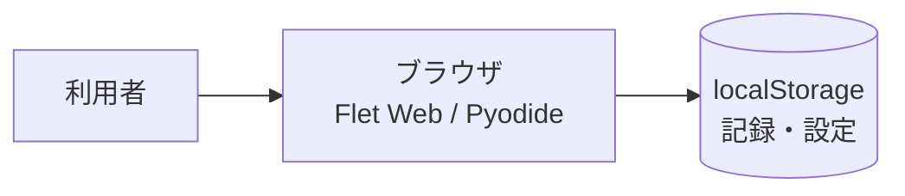

# 卒業制作作品報告書

※本ファイルは `graduation_project_template.md` の記入例である。作品・人物・数値はすべて架空のものである。

## 1. 基本情報

- **作品名**：なくしもの探知機（Lost Items Finder）
- **英語タイトル**：Lost Items Finder: Predicting Where Lost Household Items Are
- **制作者名**：自分
- **学籍番号**：非公開（個人情報保護のため、公開する報告書には記載しない）
- **所属ゼミ・研究室**：kklab
- **制作期間**：2026年4月〜2026年10月
- **作品の種類**：Webアプリ（フロントエンド：Flet / Pyodide、推論エンジン：グラフRWR）
- **作品URL**：https://shin488.github.io/lost-items/
- **ソースコードURL**：https://github.com/shin488/lost-items
- **デモ動画URL**：なし

---

## 2. 作品概要

### 2.1 概要

本作品は、家庭内で使いたい人々が、忘れ物（スマートフォン・財布・鍵・イヤホン等）を記録し、家族間で共有し、推論によって見つかりそうな場所を探して解決までを支援するWebアプリケーションである。Flet 0.85.2によるWeb UIと、Python製推論エンジン（RWR）で構成。

### 2.2 一言で表すと

**本作品は、家庭内で使いたい人々が、忘れ物の記録・共有・探索・解決を、1つのアプリで完結できるようにするWebアプリである。**

### 2.3 作品の特徴

- 特徴1：記録ベースのRWR推論による場所予測。
- 特徴2：間取り（部屋>家具>スポット）の階層的定義と連携。
- 特徴3：PWA（Service Worker / manifest）による家庭内での継続利用。

## 3. 背景と問題意識

### 3.1 制作の背景

日常生活において、スマートフォンや財布、鍵等の持ち物が家庭内で置き忘れられ、本人が気づかないうちに紛失となるケースがある。また、家族間で「探している」という認識があっても、思い出せない・探す手間があるため放置される。本プロジェクトは、こうした家庭内の忘れ物を記録→共有→探索→解決の1つの流れで扱えるようにするものである。

### 3.2 解決したい課題

1. 思い出せない：忘れた本人・家族が、何が・いつ・どこで紛失したかを思い出せない。
2. 探す手間：家族など「探す側」が、過去の文脈を踏まえた探索を行うことが難しい。
3. 解決の不完全さ：見つかったかどうかを記録し、次回以降の探索や分析に活かせていない。

### 3.3 既存の方法とその限界

| 既存の方法 | 主な特徴 | 課題・限界 |
|---|---|---|
| SNSやWeb検索で本人に問い合わせる | 気軽に尋ねられる | 本人への認知が難しく、放置されるケースがある |
| 紙やメモアプリでの手動記録 | 最低限の記録は可能 | 検索・予測・分析の基盤がなく、再利用されない |
| 紛失用品の保管ボックス／防犯用品 | 第三者による保管・防止 | 本来「探してほしい」持ち主が利用できない |

## 4. 想定する利用者

### 4.1 主な利用者

- 忘れた本人（スマートフォン・財布・鍵等の持ち主に紛失が発生し、本人・家族・同乗者の間で探す側が利用する）。
- 家族・同乗者（紛失時の探索を主導する「探す側」）。

### 4.2 ペルソナ

| 項目 | 内容 |
|---|---|
| 名前 | 瑞穂太郎（みずほたろう） |
| 年齢・職業 | 26歳・IT企業勤務の社会人 |
| 生活環境 | 東京都内で一人暮らし。買い物時はまとめ買いをする習慣がある。 |
| 困っていること | スマートフォンをカバンに入れ忘れ、3日間放置してしまい、気づいたときには自宅のソファの裏にあった。 |
| 現在の対処方法 | SNSで「スマホ落ちた」と投稿するが、見つからず放置した。 |
| この作品に期待すること | 次回、どこに置き忘れそうかを記録しておけば、次回の探索で過去の文脈を踏まえて見つけやすくなる。 |

### 4.3 その他のステークホルダー

- 家族：高齢者の認知機能の低下や、子ども（子供）の所在確認など、探索の主体となる場合がある。
- 行政・地域：行方不明者・紛失品の把握など、地域全体での見守りの基盤になり得る。
- 引っ越し業者・不用品回収業者：紛失品の回収・保管サービスを利用する側。

## 5. 提案する解決方法

### 5.1 コンセプト

本作品のコンセプトは「**探す人が、探す負担を減らす**」ことである。利用者が失物を記録し、過去のデータと推論に基づいて「見つかりそうな場所」を予測すれば、探索は思い出に頼らず、体系的な検索へ移行できる。

### 5.2 提供する価値

- 記録者が失物を失った瞬間に情報を蓄積でき、探索の土台となる。
- 推論エンジンが記録から傾向を算出し、探索の選択肢を提示する。
- 解決が「found_date」等として記録され、分析で振り返れる。

### 5.3 主要機能

| 機能名 | 機能の説明 | 解決する課題 |
|---|---|---|
| 探索機能 | テキスト入力・履歴チップ・ランキングからの検索を、RWR推論で場所予測して結果表示 | 思い出せない |
| 記録機能 | なくした物・カテゴリ・日時・場所の入力と保存、編集・削除・解決 | 検索基盤の欠如 |
| 間取り連携 | 行×列グリッド上の部屋・家具・スポットの階層的指定 | 場所不明 |
| ランキング | よくなくした物の傾向ランキング | 頻度の把握 |
| 分析 | 月間カレンダー・解決率・発見までの時間・スポット分析 | 改善循環 |
| PWA / 自動デプロイ | GitHub Pages + Service Worker + GitHub Actions | 継続利用 |

## 6. 利用シナリオ

### 6.1 基本的な利用の流れ

1. 利用者が探すタブで、なくした物（例：スマホ）を入力する。
2. 検索が実行され、過去の記録とRWR推論から見つかりそうな場所が結果として表示される。
3. 結果に基づいて実際の場所を探し、見つけたら「解決」として記録する。
4. 分析タブで解決状況・発見までの時間などを振り返る。

### 6.2 ユーザーストーリー

> 家族として、  
> 高齢の親のスマートフォンがどこにあるか分からなくなったとき、  
> 過去の「探した」記録や推論結果を頼りに、  
> スマートフォンを探し見つけることができる。  
> 見つかったことは記録され、次回以降の探索や分析に活かされる。

## 7. 画面と操作方法

### 7.1 画面構成

作品のメイン画面は5タブで構成される。

1. **探す**：テキスト入力・検索ボタン・履歴チップ・ランキングからの検索・結果表示。
2. **記録**：なくした物の入力・カテゴリ・日時・場所の入力・「記録する」。
3. **間取り**：行×列グリッド・セル編集・家具・スポット設定。
4. **ランキング**：よくなくした物のランキング。
5. **分析**：月間カレンダー・解決状況・発見までの時間・スポット分析。

### 7.2 操作手順

1. アプリ起動 → 「探す」タブで検索。
2. 結果カード（場所・割合・根拠）を確認。
3. 見つけたら「記録」タブの該当エントリを「解決」。
4. 「分析」タブで振り返り。

### 7.3 その他の画面

- 入力画面：記録タブ。なくした物（必須）、カテゴリ、なくした日（任意）、見つかった場所（必須）、間取りからの選択。
- 結果画面：検索結果カード。場所・割合（%）・「根拠: 関連記録名」・トップ判定。

## 8. システム構成

### 8.1 システム全体像



### 8.2 使用技術

| 分類 | 使用技術 | 使用目的 |
|---|---|---|
| フロントエンド | Flet 0.85.2 / Flutter Webエンジン | UI構築（コマンド形API） |
| ロジック | Python 3 / Pyodide | RWR推論エンジン（predict.py） |
| 永続化 | localStorage / page.client_storage | 記録・カテゴリ・間取り |
| 公開基盤 | GitHub Pages + GitHub Actions | ビルド・デプロイ |
| その他 | PWA（Service Worker / manifest） | オフラインキャッシュ |

### 8.3 データの流れ

1. 入力：検索クエリ（テキスト・カテゴリ）または記録の作成。
2. 処理：localStorageから記録を読み込み、predict.unified_predictで推論。
3. 出力：上位場所・割合・根拠の結果表示。
4. フィードバック：記録の解決・追加 → 再推論・分析。

## 9. AI・エージェントの利用

### 9.1 AIの役割

本作品における「AI」は、主に推論エンジン（グラフRWR）を指す。RWRの重み付け・反復・類似度計算により、紛失記録から場所スコアを伝播させる。

### 9.2 AIを利用する理由

- 記録数が少ない場合でも、デフォルト傾向（DEFAULT_TENDENCIES）から回答を返すため、探索の初期応答が得られる。

### 9.3 AIへの入力と出力

| 項目 | 内容 |
|---|---|
| AIへの入力 | 検索クエリ、カテゴリ絞り込み、記録プール、時刻情報（曜日・時間・経過日数） |
| AIが行う処理 | アイテム→場所マップ、場所類似度マップの構築、RWR反復、時刻加重統合 |
| AIからの出力 | 上位場所リスト、割合（%）、根拠（関連記録名） |

### 9.4 プロンプト設計

```python
RWR_ALPHA = 0.3
RWR_ITERATIONS = 20
RWR_CONVERGENCE = 1e-8
LOC_SIM_THRESHOLD = 0.15
LOC_SIM_DECAY = 0.3
LOC_TEMPORAL_WEIGHT = 0.4
LOC_TEMPORAL_BASE = 0.6
RECENCY_HALFLIFE_DAYS = 30
```

### 9.5 誤りへの対策

- fuzzy_matchによる部分一致、デフォルト傾向へのフォールバック、解決済みデータの扱い。

## 10. 制作過程

### 10.2 制作中に発生した問題

- 問題：Flet 0.85.2で白画面となる操作が多数あった（Column/TabBar等のbgcolor指定、NavigationBar/Dismissibleの使用、page.bgcolor等）。
- 対応：Container/AppBarのみbgcolor使用、TabBar/TabBarViewはContainer/AppBar経由、安全なテーマ設定へ変更。
- 結果：白画面は解消。

### 10.3 当初案からの変更点

| 当初の計画 | 変更後 | 理由 |
|---|---|---|
| 単一ファイル構成 | mixins分割 | 保守性向上のため |
| Flet 0.27想定 | Flet 0.85.2 | Web/Pyodide互換性のため |
| 検索の単純化 | RWRグラフ推論 | 記録ベースの予測が必要なため |

## 11. 評価

### 11.1 評価方法

- PlaywrightによるE2Eテスト（`test_app.py` / `test_app.js`、本番URL向け）。
- `flet build web`による本番ビルドとPWAパッチ。
- GitHub Actionsによる自動デプロイ検証。

### 11.2 評価対象

- 制作者自身および実環境での利用確認。

### 11.3 評価項目

- 探索の有用性（入力→結果→表示）。
- 記録の容易性（バリデーション→保存→履歴反映）。
- 分析の有用性（解決率・発見時間・スポット分析）。

### 11.4 評価結果

- 探索：空欄時にスナックバー表示、検索実行→RWR推論→結果カード表示、一般的な傾向時も案内。
- 記録：必須項目未入力時にスナックバー、保存→スナックバー「記録しました」→履歴更新。
- 解決：解決押下→resolvedフラグ設定→スナックバー「見つかりました！」→分析反映。

### 11.5 評価結果を受けた改善

- フローチャートによる操作設計の明文化、READMEへのドキュメント化。

## 12. 倫理的・法的・社会的課題

### 12.1 個人情報とプライバシー

- データは利用者のブラウザ（localStorage）に保存され、プライバシー配慮ができる構成。

### 12.2 安全性

- 推論は参考情報であり、実際の所在の保証ではない。利用者には「一般的な傾向」表示時の注意喚起を行っている。

### 12.3 公平性と偏り

- スマートフォンやアプリ環境を持たない層、あるいは記録を行わない層への対応が課題。

### 12.4 著作権・知的財産権

- Flet / Flutter（Apache License 2.0）、Pyodide、GitHub Actions等を利用。ライセンス遵守。

### 12.5 対策

- 推論結果の明示、デフォルト傾向の案内、記録の質向上。

## 13. 独自性と新規性

### 13.1 独自性

- 既存の「探す系」サービスが外部・他人のデータに依存するのに対し、本作品は**利用者自身の記録を蓄積し、自前のRWR推論で予測**する独自性がある。

### 13.2 技術的な工夫

- RWRパラメータ設計（α=0.3、反復20回、収束1e-8、時刻加重）と、階層的場所（部屋>家具>スポット）の設計。

### 13.3 SFプロトタイピングとしての意義

- 家庭内の忘れ物がAI・IoTと連携し、未来社会でどう解決されるかを物語化し、現在へのバックキャスティングを行った。

## 14. 制約と今後の課題

### 14.1 現時点での制約

- 実ユーザー・実データでの検索精度検証が不十分。
- オフライン環境での推論性能・操作感。
- 記録の質（紛失情報の精度）に依存。

### 14.2 今後追加したい機能

- 他者・家族間でのデータの共有・融通。
- 紛失時の通知・リマインダー。
- 複数世帯でのグループ管理。

### 14.3 実用化に向けた課題

- 検索精度の実証、PWAでの実利用、分析データの標準化。

### 14.4 今後の目標

- **データを保持できるようにすること**：現状は利用者ごとのブラウザlocalStorageに保存する構成であるが、長期的な蓄積・バックアップ・端末間での同期を担うデータ保持基盤を将来構築する。
- **複数人で共有できるようにすること**：家族・共同生活単位でのデータ共有（閲覧・編集・解決状況の共有）を可能にする仕組みを将来構築する。
- **Cloudflareでデータ保持する機能**：今後はCloudflare（Workers / R2等）を使ったデータ保持機能を構築したい。
- **他リポジトリでさらに高度な機能**：今後は、他リポジトリでさらに高度な機能（AI・画像認識などを含む高度な予測機能）を開発する。

## 15. 制作を通じて学んだこと

### 15.1 技術面で学んだこと

- Flet Web / Pyodide制約（宣言的API不可、bgcolor禁止、on_change→on_select）への対応。
- UIをMixinに分割し、コマンド形APIで実装する方針。

### 15.2 企画・設計面で学んだこと

- フローチャートによる操作設計の明文化が、要件・設計の一貫性に寄与した。

### 15.4 今後に生かしたいこと

- Flet / Pyodide / GitHub Pages構成でのWebアプリ開発の知見を他プロジェクトに応用する。

## 16. まとめ

本作品「なくしもの探知機」は、家庭内で使いたい人々が、忘れ物の記録・共有・探索・解決を1つのアプリで完結できるようにするWebアプリである。RWR推論エンジンとフローチャートによる設計ドキュメント化により、限られた記録数でも有用な回答を導出している。

## 17. 生成AI利用記録

### 17.1 生成AIを利用した作業

- コード補助、文章作成、Mermaid図の生成支援、設計検討の壁打ち。

### 17.2 制作者自身が行った判断・修正

- RWRのパラメータ設計（α、反復回数、収束条件）は制作者が決定。
- Fletの制約対応は制作者が判断。

### 17.3 代表的な対話例

```text
入力した指示：
lost-itemsのpredict.pyにRandom Walk with Restart（RWR）の推論を実装してほしい。

生成AIの出力：
RWR_ALPHA=0.3, RWR_ITERATIONS=20, RWR_CONVERGENCE=1e-8 等を用いた反復推論のコードが提案された。

制作者による評価・修正：
アルゴリズムの方向性は採用したが、収束条件や類似度閾値は制作者が
constants.pyで調整し、テストを実行した。
```

## 18. 付録

### 18.1 インストール方法

```bash
pip install -r requirements.txt
flet run
flet build web --base-url /lost-items
bash scripts/patch-pwa.sh
```

### 18.2 動作環境

- Python 3.12 / flet 0.85.2 / ブラウザ（Web）。

### 18.3 テスト用アカウント

- なし（localStorageベースのデータ保存のため、実機確認は利用者ごとのブラウザデータで行う）。

### 18.4 その他の画像

- 本報告書で使用する画像は本プロジェクトに添付されていない。

### 18.5 関連ファイル

- `main.py`, `app.py`, `mixins/`, `predict.py`, `storage.py`, `constants.py`, `utils.py`, `ui_components.py`, `README.md`（フローチャート）, `.github/workflows/deploy.yml`, `scripts/patch-pwa.sh`, `pwa/`。
