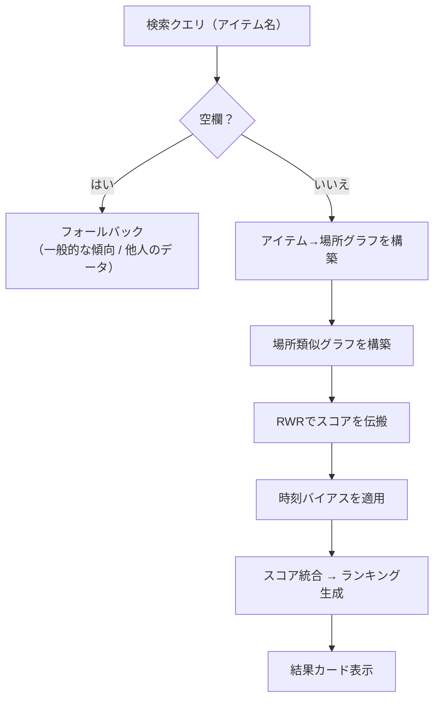

# 過去の情報からの予測ロジック（Predict Logic）

**なくしもの探知機**における「過去の記録から紛失場所を予測する」ロジックの説明。

## 方針

- **個人データ優先**： 自分の（家族の）記録から予測し、ランキングを作成する。
- **データなければフォールバック**： 個人データで結果が得られなければ、一般的な傾向（または共有データ）から予測する。

## 処理の流れ

## 各ステップの詳細

### 1. 検索とフォールバック

- `unified_predict(query_name, records, search_cat, fallback=None)` が入口。
- クエリが空、または該当する個人記録が無い → フォールバックへ。
- 個人データから予測し、結果が得られたら → それをランキングとして採用（個人データ優先）。
- フォールバック未指定時 → 内部汎用データ（`DEFAULT_TENDENCIES`）を使用。共有機能実装時は「他人のデータ」を注入して使う。

### 2. グラフ構築

- **アイテム → 場所**： 個人記録から `name → {場所: 出現回数}` を構築。
- **場所 → アイテム**： 逆方向マップを構築。
- **場所類似**： 2 つの場所が共通して紛失されたアイテムを 1 つでも持つ場合、Jaccard 類似度 `|共通| / |和集合|` を計算し、閾値（0.15）以上なら関連付ける。

### 3. RWR（反復重み付き伝搬）

- シードとなる場所にスコア `1 / シード数` を与える。
- 場所間で類似スコアを伝搬（減衰係数 `LOC_SIM_DECAY = 0.3`）。
- `RWR_ALPHA = 0.3` で個人シードと伝搬結果をブレンドし、収束するまで反復（最大 20 回、収束閾値 `1e-8`）。

### 4. 時刻バイアス

- 紛失→発見の曜日の重み、時間の proximity、経過日数（半減期 30 日）を加味して、場所ごとの時刻スコアを算出。
- 統合係数：`LOC_TEMPORAL_BASE = 0.6`、`LOC_TEMPORAL_WEIGHT = 0.4`。

### 5. 統合とランキング

- 場所スコアと時刻スコアを統合 → 全場所の合計に対する割合（％）を計算。
- 最大スコアの場所を top 判定（同点時は先頭を top に）→ 降順ソートして結果カードへ。

## パラメータ一覧

| 定数 | 値 |
|---|---|
| `RWR_ALPHA` | 0.3 |
| `RWR_ITERATIONS` | 20 |
| `RWR_CONVERGENCE` | 1e-8 |
| `LOC_SIM_THRESHOLD` | 0.15 |
| `LOC_SIM_DECAY` | 0.3 |
| `LOC_TEMPORAL_BASE` / `LOC_TEMPORAL_WEIGHT` | 0.6 / 0.4 |
| `RECENCY_HALFLIFE_DAYS` | 30 |
| `RELATED_SCORE_THRESHOLD` | 0.01 |

## 関連

- 実装：`predict.py`
- テスト：`test_predict.py`
- フローチャート：`README.md`
