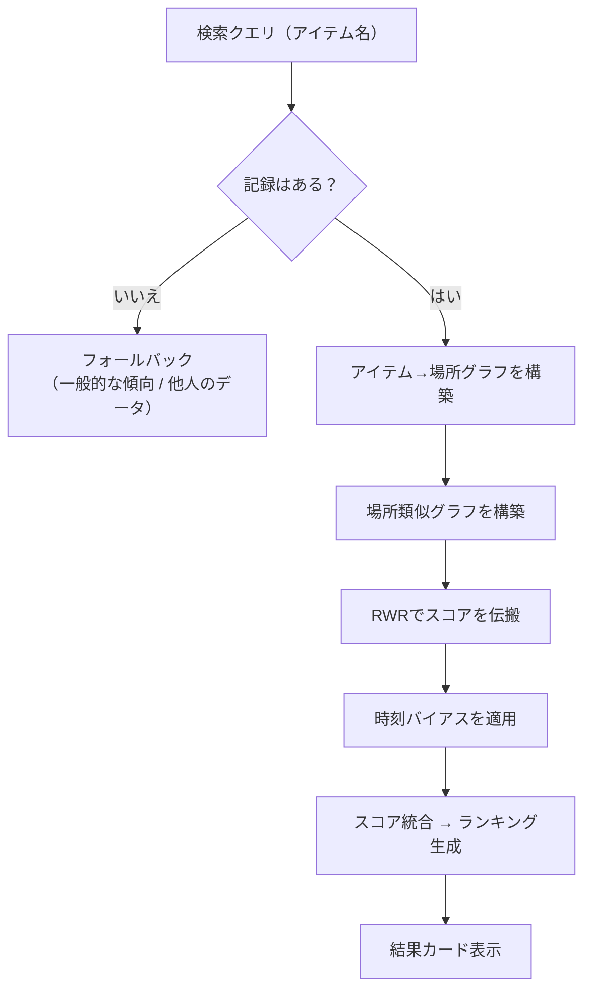

# 過去の情報からの予測ロジック（Predict Logic）

**なくしもの探知機**における「過去の記録から紛失場所を予測する」ロジックの説明。

## 方針

- **個人データ優先**： 自分の（家族の）記録から予測し、ランキングを作成する。
- **データなければフォールバック**： 個人データで結果が得られなければ、一般的な傾向（または共有データ）から予測する。

## 処理の流れ

## 各ステップの簡単な説明

### 1. 検索とフォールバック
- アイテム名が空、または記録が無い → フォールバック（一般的な傾向 / 他人のデータ）でランキングを作成
- 個人データから予測して結果が得られたら → それをランキングとして採用（個人データ優先）

### 2. グラフ構築
- アイテム → 場所 のマップ
- 場所 → アイテム のマップ
- 場所類似度： 共通アイテム比率が閾値（0.15）以上なら場所同士を関連付ける

### 3. RWR（反復重み付き伝搬）
- シード（該当アイテムの場所）から出発し、場所類似度を減衰しながらスコアを伝搬
- 収束するまで反復（最大 20 回 / 収束閾値 1e-8）

### 4. 時刻バイアス
- 見つかった曜日の重み × 時間の proximity × 経過日数（半減期 30 日）を加味

### 5. 統合とランキング
- スコアを統合 → 割合（%）を計算 → top 判定 → 降順ソートして結果カードへ

## 関連

- 実装：`predict.py`
- テスト：`test_predict.py`
